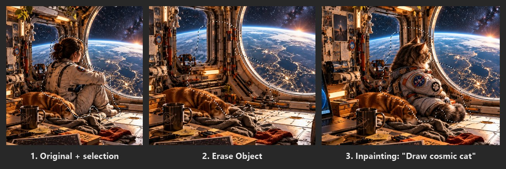
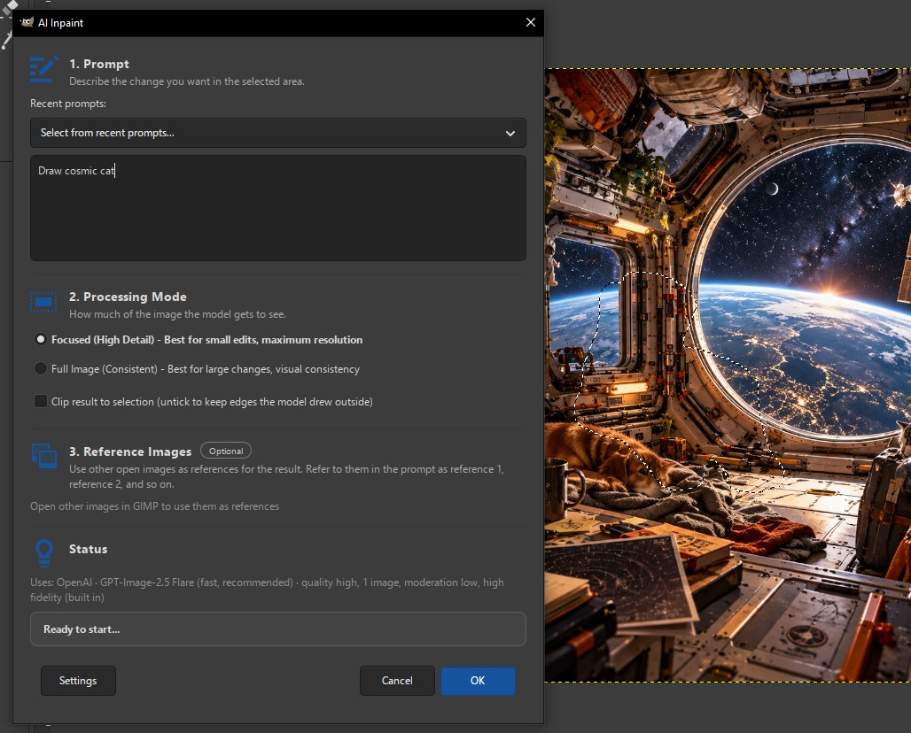
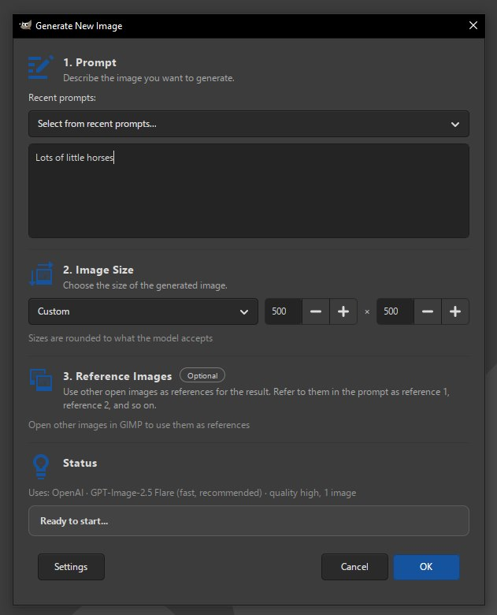
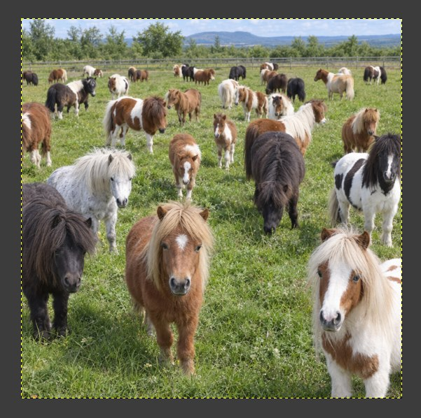
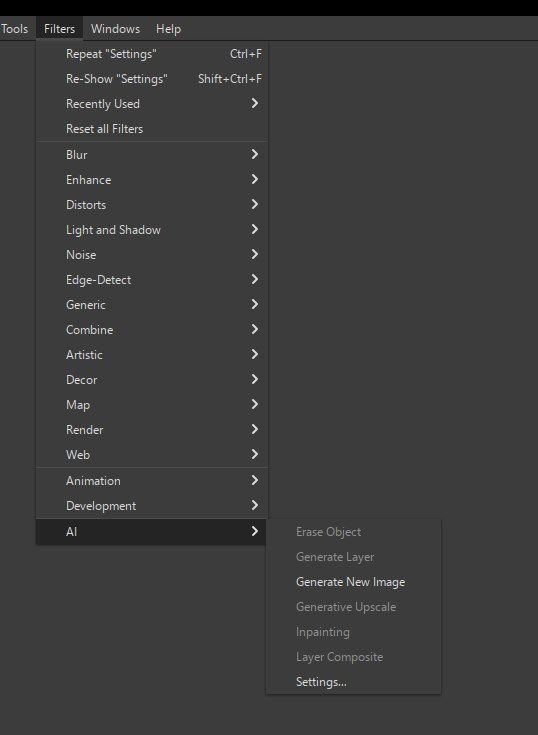
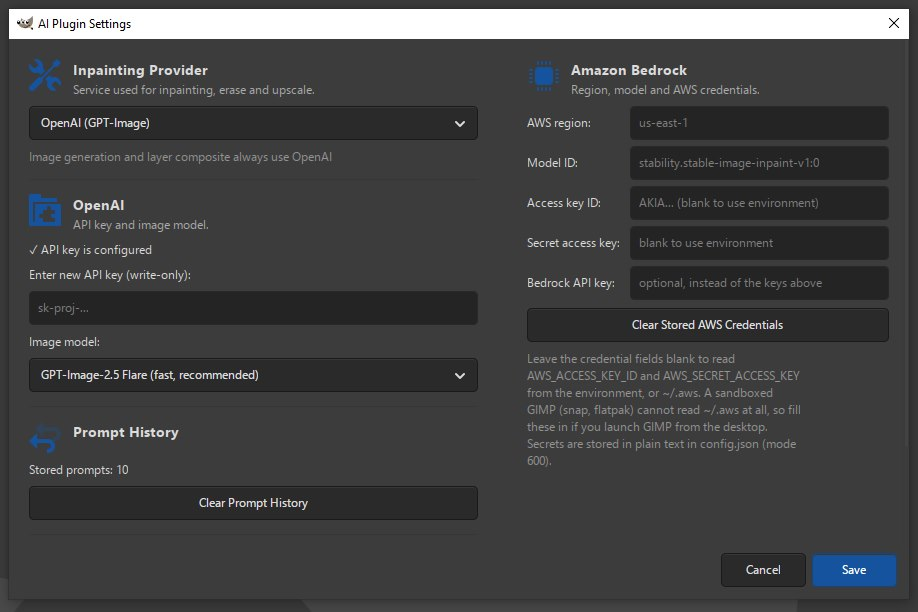

# GIMP AI Plugin

**AI inpainting, object removal, generative upscaling and image generation - right inside GIMP 3.**

Select something, type what you want, get a new layer. No exporting, no browser
tabs, no round trips: results land in your image as ordinary layers you can
mask, compare and undo.

  

<em>Two clicks in GIMP: erase the astronaut, then ask for a cosmic cat in the same spot.</em>

## What it does

- 🎨 **Inpainting** - fill a selection from a text prompt, at your image's native resolution
- 🧹 **Erase Object** - select a photobomber, click once, pick the best of three clean results
- 🔍 **Generative Upscale** - enlarge a layer up to 4x with real detail instead of blur
- 🖼️ **Image Generation** - text to image as a new layer or a new file, optionally guided by reference images
- 🔄 **Layer Composite** - blend pasted-in elements naturally into a scene

Powered by **OpenAI GPT-Image** (2.5 Flare, 2.5 Sunburst, gpt-image-1) or
**Amazon Bedrock** (Stability AI) - your choice, your API key.

## See it in action

**Inpainting** - select an area, describe the change, pick how much of the image
the model gets to see. Other open images can be passed in as references.

  

**Generate New Image** - type a prompt, choose a size, get a new GIMP image.
Works even with no image open.

| Prompt | Result |
|:---:|:---:|
|  |  |

## Why you might like it

- **Non-destructive** - every result is a new layer; your original stays untouched
- **Zero dependencies** - pure Python standard library, nothing to `pip install`
- **Three files, one installer** - works on Windows, macOS and Linux
- **Retries built in** - a failed request keeps the dialog open with a Try Again button

## Quick install

1. Download the [latest release ZIP](https://github.com/etet100/gimp-ai-2/releases/latest) and extract it
2. Run `python3 install_plugin.py`
3. Restart GIMP, open `Filters → AI → Settings...` and enter your OpenAI API key or AWS credentials

| Everything lives under `Filters → AI` | Pick a provider and model in Settings |
|:---:|:---:|
|  |  |

Requires **GIMP 3.0.4 or newer**. Prefer to copy files by hand, or using a
Flatpak/Snap build? See the [installation guide](https://etet100.github.io/gimp-ai-2/installation.html).

## Documentation

Everything else lives at **[etet100.github.io/gimp-ai-2](https://etet100.github.io/gimp-ai-2/)**:

- [Installation](https://etet100.github.io/gimp-ai-2/installation.html) - step by step, every platform
- [Configuration](https://etet100.github.io/gimp-ai-2/configuration.html) - OpenAI, Amazon Bedrock, `config.json` reference
- [Features](https://etet100.github.io/gimp-ai-2/features/) - how to use each tool and get the best results
- [Troubleshooting](https://etet100.github.io/gimp-ai-2/troubleshooting.html) - when `Filters → AI` does not show up, and more
- [Developers](https://etet100.github.io/gimp-ai-2/developers/) - architecture, tests, Bedrock internals, release process

What's new: [CHANGELOG.md](CHANGELOG.md).

## Beta

This is a beta and testers on all platforms - especially Windows and Linux - are
very welcome. Found a problem? [Open an issue](https://github.com/etet100/gimp-ai-2/issues).

## License

MIT - see [LICENSE](LICENSE). Fork of [lukaso/gimp-ai](https://github.com/lukaso/gimp-ai).
